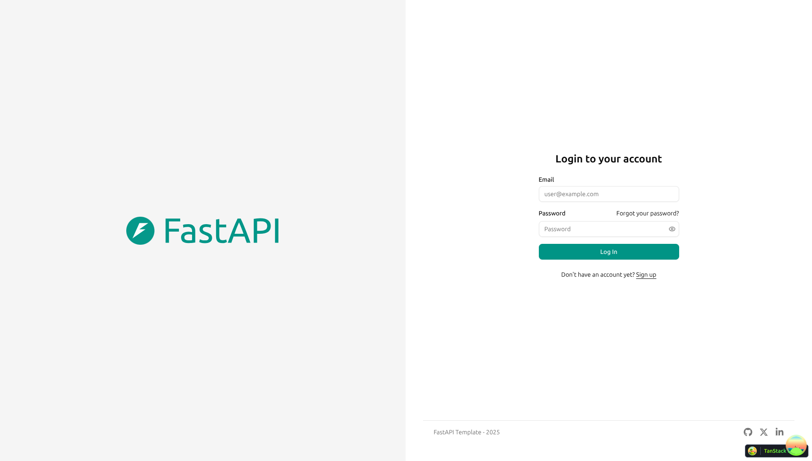
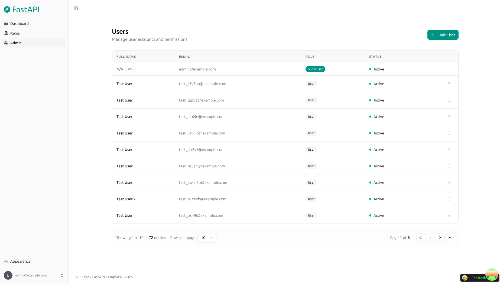
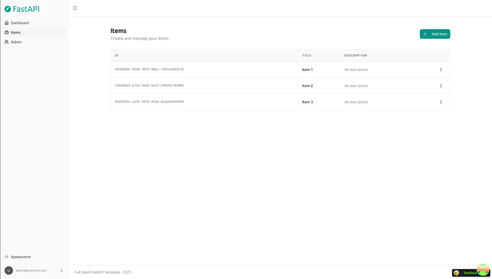
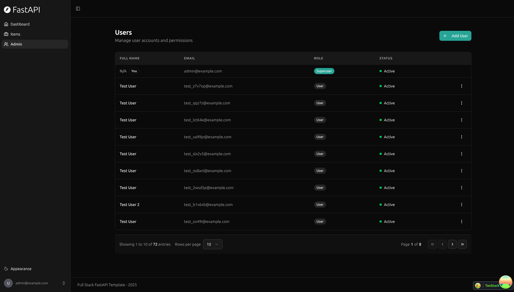
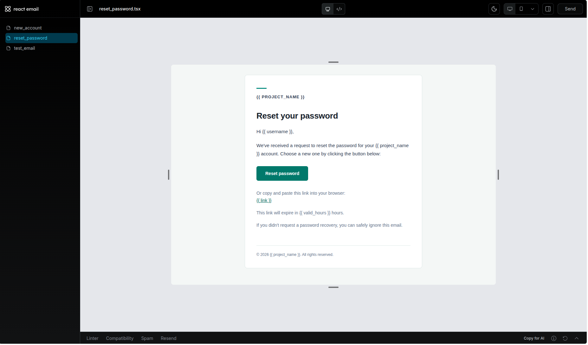
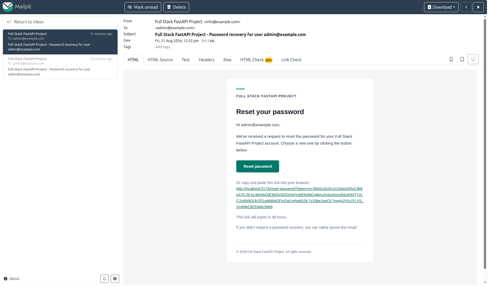
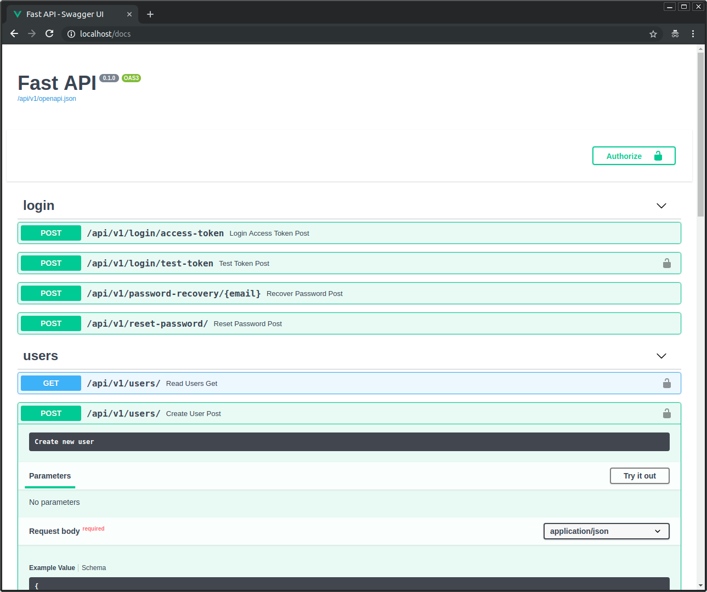

# Role-Based Access Control

This fork adds role-based access control to the Full Stack FastAPI Template with three roles: **admin**, **manager** and **member**. The backend enforces every rule; the frontend only mirrors them.

## Roles

| Role | Can do |
|---|---|
| admin | Everything: create, edit (including role and active status) and delete users; view metrics; see and manage all items; send test emails |
| manager | View the users list and any user (read-only), view metrics, manage their own items and profile |
| member | Manage their own items and profile only. Every sign-up gets this role |

Admins can't demote, deactivate or delete themselves, and the last active admin can't be removed (both return 400). Members can't change their own role or active status (422).

## How to run

Start the stack (the backend reloads on changes to `backend/app`):

```bash
docker compose watch
```

Start the frontend dev server with bun:

```bash
cd frontend
bun run dev
```

| Service | URL |
|---|---|
| Frontend | http://localhost:5173 |
| Backend API docs | http://localhost:8000/docs |
| Mailpit (local email) | http://localhost:8025 |
| Adminer (database) | http://localhost:8080 |

## Test users

The admin comes from `FIRST_SUPERUSER` / `FIRST_SUPERUSER_PASSWORD` in `.env`. The demo manager and member come from an idempotent script, which refuses to run unless `FASTAPI_ENV=development`:

```bash
docker compose exec backend python app/initial_data.py
docker compose exec backend python app/demo_data.py
```

| Role | Email | Password |
|---|---|---|
| admin | `admin@example.com` | `FIRST_SUPERUSER_PASSWORD` from `.env` (`changethis` by default) |
| manager | `manager@example.com` | `demo-password` |
| member | `member@example.com` | `demo-password` |

Re-running `demo_data.py` resets both demo users to the role, status and password above.

## Tests

**Backend.** `backend/tests` is not synced into the container, so copy it in before each run. Remove the old copy first: `docker compose cp` into an existing directory nests it as `tests/tests`, and pytest then also runs the stale copy.

```bash
docker compose exec backend rm -rf /app/backend/tests
docker compose cp backend/tests backend:/app/backend/
docker compose exec backend bash scripts/tests-start.sh
```

**Frontend (Playwright).** Run against the running stack and dev server. The tests need `VITE_API_URL` and `MAILPIT_HOST` from `frontend/.env`. The first time, install the browser:

```bash
cd frontend
bunx playwright install chromium
set -a && . ./.env && set +a
bunx playwright test
```

> [!WARNING]
> The backend tests delete **every user** when they finish, including the admin and the demo users. Re-create them afterwards:
>
> ```bash
> docker compose exec backend python app/initial_data.py
> docker compose exec backend python app/demo_data.py
> ```

## Design notes

- **Permissions map:** `backend/app/core/permissions.py` defines `Role`, `Permission` (`users:read`, `users:manage`, `metrics:read`, `items:manage_all`) and `ROLE_PERMISSIONS`. Routes check permissions through `require_permission(...)` (the user must hold all listed permissions) or `has_permission(...)`, never role names.
- **`is_superuser`:** kept as a database column only, derived from `role == admin` on every create and update. It is never used for authorization and is not part of the API.
- **401 vs 403:** an invalid or expired token, a deleted user or an inactive user returns 401, and the frontend logs out. A missing permission returns 403, and the frontend refetches `/users/me` and re-renders from the fresh permissions.
- **Per-request reload:** the JWT carries only the user id. The user and their role are loaded from the database on every request, so role and active-status changes apply to existing sessions immediately.
- **Migration** (`7d1741bee867`): adds `user.role VARCHAR(20) NOT NULL DEFAULT 'member'` with a CHECK constraint and backfills existing superusers to `admin`. The downgrade sets `is_superuser = (role = 'admin')` and then drops the column.
- **`/users/me`** returns the role and the list of permissions; the frontend's `usePermissions` hook, sidebar and route guards read that list.

## Known limitations and deploy notes

- **Last-admin race:** the "last active admin" check is check-then-act with no row locking. Two admins demoting each other at the same moment can leave zero active admins.
- **Migration lock:** adding the CHECK constraint scans the whole `user` table under an exclusive lock. Fine at this size; for a large table, add it as `NOT VALID` and validate separately.
- **Rolling deploys:** while old and new code run side by side, old code can still grant `is_superuser` without changing `role`; those grants are lost after the rollout or a downgrade. Deploy backend and migration in one step.
- **Downgrade loses managers:** the old schema has no manager role, so after a downgrade and re-upgrade, managers come back as members.
- **Upstream bug:** `POST /api/v1/login/password-recovery-html-content/{email}` crashes for existing users because it sets an invalid `"subject:"` response header (`backend/app/api/routes/login.py`). Left as is.
- **Flaky e2e tests:** the two reset-password Playwright tests can time out waiting for the email in Mailpit when the full suite runs in parallel; they pass on rerun.
- **Button flicker:** on a direct page load, "Add User" and the row actions in the users table appear only once `/users/me` has loaded (a fraction of a second).
- **Out of scope:** a security review also found pre-existing template issues that this work does not change: reset tokens are tied to an email address and stay valid for 48h; password changes don't revoke existing access tokens; the first admin is re-created from `.env` by email on startup; status codes reveal whether an email or item id exists; access and reset tokens share a key with no token-type claim.

---

# Full Stack FastAPI Template

[](../../actions/workflows/test-docker-compose.yml)
[](../../actions/workflows/test-backend.yml)

## Technology Stack and Features

- ⚡ [**FastAPI**](https://fastapi.tiangolo.com) for the Python backend API.
  - 🧰 [SQLModel](https://sqlmodel.tiangolo.com) for the Python SQL database interactions (ORM).
  - 🔍 [Pydantic](https://docs.pydantic.dev), used by FastAPI, for the data validation and settings management.
  - 💾 [PostgreSQL](https://www.postgresql.org) as the SQL database.
- 🚀 [React](https://react.dev) for the frontend.
  - 🧩 Built into the backend application and served by FastAPI on the same domain as the API.
  - 💃 Using TypeScript, hooks, [Vite](https://vitejs.dev), and other parts of a modern frontend stack.
  - 🎨 [Tailwind CSS](https://tailwindcss.com) and [shadcn/ui](https://ui.shadcn.com) for the frontend components.
  - 🤖 An automatically generated frontend client.
  - 🧪 [Playwright](https://playwright.dev) for end-to-end testing.
  - 🦇 Dark mode support.
- ☁️ [FastAPI Cloud](https://fastapicloud.com) for deployment.
- 🐋 [Docker Compose](https://www.docker.com) for local services and self-hosted deployment.
  - 📞 [Traefik](https://traefik.io) as a reverse proxy with automatic HTTPS.
- 🔒 Secure password hashing by default.
- 🔑 JWT (JSON Web Token) authentication.
- 📫 Email-based password recovery.
- ✉️ [React Email](https://react.email) for email templates.
- 📬 [Mailpit](https://mailpit.axllent.org) for local email testing during development.
- ✅ Tests with [Pytest](https://pytest.org).
- 🏭 CI (continuous integration) and CD (continuous deployment) based on GitHub Actions.

### Dashboard Login



### Dashboard - Admin



### Dashboard - Items



### Dashboard - Dark Mode



### React Email Templates



### Mailpit - Local Email Testing



### Interactive API Documentation



## How to Use It

Click the **Use this template** button at the top of this page to create a new repository.

## Backend Development

Backend docs: [backend/README.md](./backend/README.md).

## Frontend Development

Frontend docs: [frontend/README.md](./frontend/README.md).

## Deployment

FastAPI Cloud deployment: [deployment.md](./deployment.md).

Self-hosted deployment with Docker Compose: [deployment-docker-compose.md](./deployment-docker-compose.md).

## Development

General development docs: [development.md](./development.md).

This includes the local FastAPI and Vite workflow, Docker Compose services, `.env` configuration, and more.

## Release Notes

Check the file [release-notes.md](./release-notes.md).

## License

The Full Stack FastAPI Template is licensed under the terms of the MIT license.
